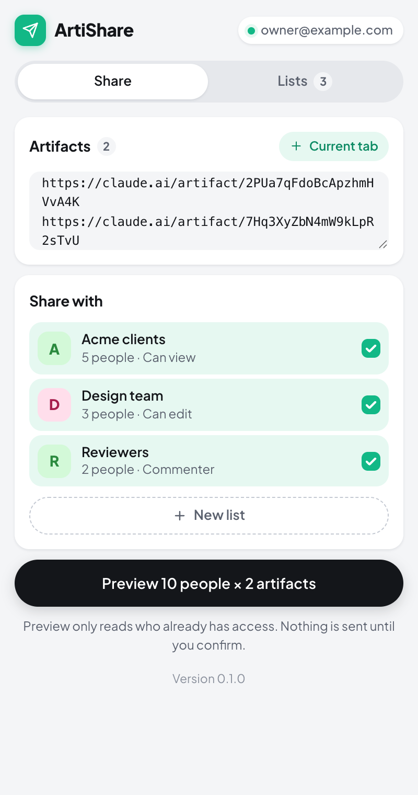
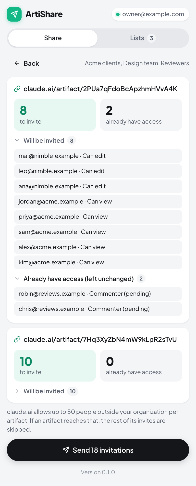
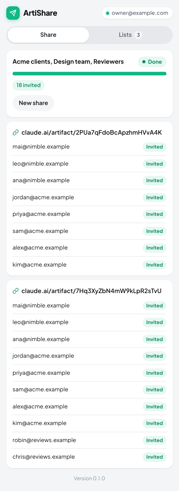
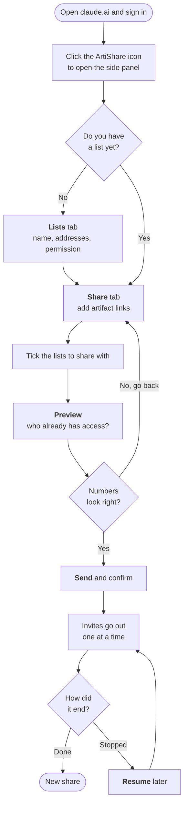

# ArtiShare

**Share a claude.ai artifact with a whole group of people in a few clicks.**

ArtiShare is a Chrome extension. You save groups of email addresses as **lists** once. After that you can invite a list (or several) to one or more artifacts at once, without adding each person through the Share menu and without making the artifact public.

<p align="center">
  
  &nbsp;
  
  &nbsp;
  
</p>

> **Status:** reading who has access works against claude.ai. Sending an invite uses the same request as the Share menu ([docs/claude-share-api.md](docs/claude-share-api.md)), but it hasn't been tested on a live artifact yet. Try it on a throwaway artifact first.

## Contents

- [How it works](#how-it-works)
- [Install](#install)
- [Use it](#use-it)
- [Good to know](#good-to-know)
- [Limits](#limits)
- [For maintainers](#for-maintainers)

## How it works



ArtiShare works inside your own signed-in claude.ai session. It never asks for your password, never removes anyone, and never lowers anyone's access.

## Install

You install it once. After that it starts with Chrome like any other extension. You only need Chrome (or another Chromium browser): no terminal, no Node, no server.

1. Get `artishare-<version>-chrome.zip` from the team's shared drive.
2. Unzip it into a folder you'll keep, for example `~/Applications/ArtiShare`. Chrome loads the extension from this folder every time, so **don't leave it in Downloads** and don't delete it.
3. Open `chrome://extensions` and turn on **Developer mode** (top right).
4. Click **Load unpacked** and pick that folder.
5. Pin **ArtiShare** in the toolbar. Clicking the icon opens the side panel.

The extension's card should show the ID `eeihicglfclmofckclcpjleekpddjflg`. It's the same on every machine, whichever folder you use.

**To update:** replace the folder's contents with the new zip's, then click the reload icon ↻ on the extension's card. Your lists and settings are kept. The installed version is shown at the bottom of the side panel.

## Use it

Open claude.ai and sign in, then click the ArtiShare icon. The side panel has two tabs: **Lists** and **Share**.

### 1. Make a list

In the **Lists** tab, click **New list**:

- **Name** it, for example *Design team*.
- **Paste the addresses** in any shape: one per line, comma-separated, `Name <a@b.com>`, or cells copied from a spreadsheet. The counter shows how many are valid. Duplicates are dropped and invalid addresses are flagged.
- **Pick the permission** everyone on this list gets: *Can view*, *Commenter* or *Can edit*.

Click **Save list**. To change a list later, click it to open it, edit, and **Save**.

### 2. Choose the lists that are ticked by default

At the top of the **Lists** tab, **Ticked by default when sharing** decides which lists are already ticked when you open the Share tab:

- **All lists**, or
- **Only these**, then tick the lists you share with most.

You can still tick or untick any list each time you share.

### 3. Pick artifacts and lists

In the **Share** tab:

- **Artifacts:** if the current tab is an artifact, its link is already filled in. Add more links (one per line), or open another artifact and click **+ Current tab**.
- **Share with:** tick the lists to invite. Need a new group? Click **+ New list** to make one without leaving the tab.

Click **Preview**. The button shows how many people and artifacts are involved.

### 4. Check the preview

Preview only **reads** who already has access to each artifact. Nothing is sent yet.

For each artifact you see:

- **To invite:** the people who will get an invitation, with their permission.
- **Already have access:** people who are skipped, and their access stays as it is.

If something looks wrong, click **Back** and change it. When it's right, click **Send** and confirm.

### 5. Watch it run

Invites go out one at a time from the background, with a short pause between them, so you can close the side panel or keep working. Each address moves from *Pending* to *Invited* (or *Failed* / *Skipped*, with the reason).

- **Stop** pauses the run. **Resume** continues where it left off.
- If the browser restarts mid-run, the run is kept and can be resumed.
- When it's done, click **New share** to start again.

## Good to know

- **Sharing again is safe.** Anyone who already has access is skipped, so you can share the same list to the same artifact as often as you like. Only new people are invited.
- **Two lists, one person.** If someone is in two ticked lists, they get the higher of the two permissions.
- **Your own address is skipped**, since you own the artifact.
- **Rate limits are handled.** The run backs off and retries when claude.ai asks it to slow down, and it stops after repeated failures instead of hammering the server.

## Limits

These come from claude.ai's own sharing rules ([help article](https://support.claude.com/en/articles/9547008)):

| Limit | What ArtiShare does |
| --- | --- |
| **At most 50 people outside your organization per artifact.** Pending invitations count toward it. | When an artifact reaches it, the rest of that artifact's invites are skipped and the run moves on to the next artifact. |
| **A daily invitation limit per account.** | The run stops and keeps the rest pending. **Resume** the next day. |
| **Outside invitations expire after 30 days** if they aren't accepted. | Sharing again renews expired invitations. |
| **Artifacts that connect to other websites** can't be shared by email. | Nothing it can work around: share those another way. |
| **Enterprise plans:** an admin must turn on *Email invitations outside your organization* (Organization settings → Artifacts). | Ask your admin to turn it on first. |

Email sharing on claude.ai is in beta and has no public API. ArtiShare uses the same requests as the Share menu, so a change on claude.ai's side can break it. The preview step would show that before anything is sent.

## For maintainers

You only need this section to change or publish the extension.

### Publish a new version

1. Bump `version` in `package.json`.
2. Run the release script. It runs the typecheck and tests, builds, and writes `.output/artishare-<version>-chrome.zip`.
3. Upload the zip to the shared drive and tell the team to update.

```bash
npm install
```

```bash
npm run release
```

The manifest's `key` in `wxt.config.ts` pins the extension ID. Without it, Chrome derives the ID from the folder path, so unzipping an update into a different folder would look like a new extension and lose everyone's saved lists. Don't remove or change the key.

A Chrome Web Store listing would give one-click installs and automatic updates. Registering as a Chrome Web Store developer costs $5 once.

### Develop

```bash
npm run dev        # opens Chrome with the extension and reloads on change
npm run dev:fake   # same, with an in-memory fake claude.ai: nothing is sent
npm test           # unit tests (Vitest)
npm run typecheck
npm run build:fake # fake build in .output/chrome-mv3-fake
```

The dev server listens on port **47613** (set in `wxt.config.ts`). If that port is busy, WXT moves to the next free one. The built extension uses no port; it only talks to claude.ai over HTTPS.

**Fake mode** lets you click through the whole flow safely. The screenshots in this README come from it. Its fake claude.ai behaves like this:

- an artifact whose ID contains `Forbidden` rejects every invite
- an address starting with `fail` is rejected
- an address starting with `slow` is rate-limited once, then succeeds

### Project layout

```
src/
  core/         framework-free logic, unit-tested: email parsing, artifact links, saved lists
                (schema and upgrade from 0.1.0), planner (who to invite), runner (queue, retry, stop)
  claude/       ShareClient interface, the claude.ai client, the fake client, and in-page fetch
  lib/          chrome.storage access and the side panel ↔ background message types
  entrypoints/  background worker (runs invites) and the side panel
  ui/           shared React components and styles
tests/          Vitest specs for src/core
docs/           claude.ai sharing API notes and README screenshots
```

### How it talks to claude.ai

Requests run inside a claude.ai tab (`chrome.scripting.executeScript` in the extension's isolated world). They use your existing session, and the page's own scripts can't see or change them. If no claude.ai tab is open, the extension opens one in the background. The endpoints, IDs and error reasons are written up in [docs/claude-share-api.md](docs/claude-share-api.md).
